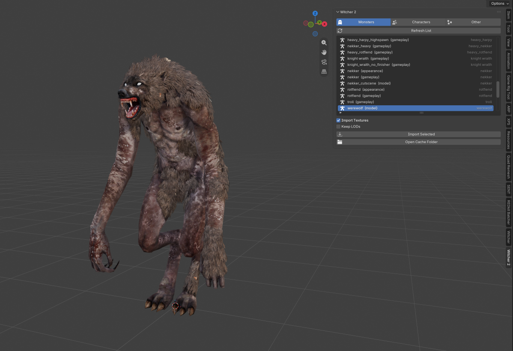

# Witcher 2 Tools for Blender

Browse the monsters, characters and animals of **The Witcher 2: Assassins of Kings**
in a list inside Blender, and import any of them **textured and rigged** with one click.

- Works directly on your own installed copy of the game. No game files are included
  or distributed.
- Your game folder is only ever **read**, never changed.
- Nothing runs in the background. The add-on only does work when you press a button.

---

## Contents

1. [Requirements](#requirements)
2. [Installation](#installation)
3. [First-time setup](#first-time-setup)
4. [Importing a model](#importing-a-model)
5. [What the list labels mean](#what-the-list-labels-mean)
6. [What you get](#what-you-get)
7. [The cache folder](#the-cache-folder)
8. [Uninstalling](#uninstalling)
9. [Troubleshooting](#troubleshooting)
10. [Known limitations](#known-limitations)
11. [Licence](#licence)

---

## Requirements

| What | Notes |
|---|---|
| **Blender 4.5 or newer** | Tested on Blender 5.2. |
| **The Witcher 2** | Your own Steam or GOG copy, installed. |
| **Witcher 3 Tools 1.1.0 or newer** | By Dingdio: <https://github.com/dingdio/Witcher3_Blender_Tools/releases>. **Required**: Witcher 2 Tools uses its Witcher 2 mesh and skeleton readers, so it must be installed and **enabled**. Use the official release; version 1.1.0 works on Blender 5.x without changes. Tested with 1.1.0 on Blender 5.2. |

## Installation

1. Download **`witcher2_tools-<version>.zip`** from this repository's
   **[Releases](../../releases)** page (right-hand side of the repository page).
   Don't unzip it.
2. Open Blender and go to **Edit → Preferences → Get Extensions**.
3. Click the **⌄** drop-down menu at the top right of that window and choose
   **Install from Disk…**
4. Select the zip you downloaded and click **Install from Disk**.
5. Install **Witcher 3 Tools** the same way if you don't have it: download its zip from
   [Dingdio's Releases page](https://github.com/dingdio/Witcher3_Blender_Tools/releases)
   and use **Install from Disk…** again. Make sure it is ticked in
   **Edit → Preferences → Add-ons**.

> The green **Code → Download ZIP** button on GitHub also works if you prefer it;
> Blender accepts that zip too.

## First-time setup

1. In **Edit → Preferences → Add-ons**, find **Witcher 2 Tools** and expand it.
2. **Witcher 2 Folder**: click the 🔍 magnifier button to find the game
   automatically (common Steam and GOG locations are searched). If it isn't
   found, click the folder icon and choose your Witcher 2 install folder: the
   one that contains the `CookedPC` folder, for example
   `C:\Program Files (x86)\Steam\steamapps\common\the witcher 2`.
3. **Cache Folder** (optional): where extracted files are stored. Leave it empty to
   use Blender's own extension folder, or pick a drive with free space. It only
   grows with what you actually import (typically a few MB per model).
4. The preferences show a green tick next to **Witcher 3 Tools found** when
   everything is ready.

## Importing a model

1. In the 3D Viewport press **N** to open the sidebar, then click the **Witcher 2** tab.
2. Choose a tab:
   - **Monsters**: arachas, bruxa, bullvore, dragon, draug, drowners, elemental,
     endriaga, gargoyle, golem, harpies, nekkers, rotfiends, troll, werewolf,
     wraiths and the Kayran.
   - **Characters**: humans, elves and dwarves: main characters (Triss, Roche,
     Iorveth, Zoltan, Dandelion and more), crowd and soldier types, bandits and
     Geralt.
   - **Other**: animals.
3. Press **Refresh List** the first time (switching tabs refreshes automatically).
4. Type in the filter box under the list to search, select an entry and press
   **Import Selected**.

Each import goes into its own collection. Options under the list:

- **Import Textures**: materials and textures (on by default).
- **Keep LODs**: also import the lower-detail versions of each mesh.

## What the list labels mean

The same creature often appears up to three times, because the game stores it in
three kinds of file. The meshes are usually the same.

| Label | What it is | When to use it |
|---|---|---|
| **(model)** | The creature's own base file, one fixed look. Some are one-off cutscene versions (e.g. `dragon_a3_flying`). | A single clean model. |
| **(appearance)** | The game's "wardrobe" for that type: **every** variant (all heads, beards, bodies, armour pieces) so the game can mix them per spawn. They import overlapping. | When you want all variants to choose from. Hide the ones you don't want. |
| **(gameplay)** | What the game actually places in the world. Mostly points at the appearance file and adds AI, inventory and effects (e.g. bandits' weapons, Triss's body). | The version you'd meet in the game. |
| **(template)** | A base template (Geralt). | |

The right-hand column of the list shows the group (monster type, or Main characters /
Crowd & soldiers / Geralt / Animals).

## What you get

- All the meshes for the entity, with their Witcher 2 textures (converted to DDS).
- One full skeleton with the body meshes bound to it.
- Face-animation ("mimic") heads keep their own small armatures, because the game
  drives them with a separate face rig.

The skeleton's **Custom Properties** (Object properties tab) show objective numbers
for how well the import lined up:

| Property | Meaning |
|---|---|
| `w2_bind_bones_within_5mm` | Bones within 5 mm of the meshes' bind pose, e.g. `105/105` |
| `w2_bind_error_mm` | Median bone error in millimetres |
| `w2_textures_loaded` | Textures found and loaded, e.g. `7/7` |
| `w2_texture_links_repaired` | Present when textures were re-connected to the shader (see below) |
| `w2_rest_pose_from_meshes` | Present when the skeleton's stored pose differed from the meshes' and was rebuilt from them (bullvore, troll, endriaga and others) |

### Materials and Witcher 3 Tools 1.1.0

Witcher 3 Tools 1.1.0 builds Witcher 2 materials around a shader group but plugs the
textures into inputs that group does not use, so models would render white.
Witcher 2 Tools detects this after each import and re-connects the colour, normal
and specular textures to the inputs the shader actually reads. Materials that are
already wired correctly are left untouched.

## The cache folder

The Witcher 2 packs its files into large `.dzip` archives. When you import
something, only the files it needs are extracted and converted into the cache, and
reused next time.

Many Witcher 2 entities store their meshes and skeletons *inside* the entity file.
The add-on writes those back out as standalone files in the cache so they can be
imported.

**Deleting the cache folder is always safe**; it is rebuilt when needed. The
**Open Cache Folder** button in the panel shows where it is.

## Uninstalling

**Edit → Preferences → Add-ons → Witcher 2 Tools → ⌄ → Uninstall**, then delete the
cache folder if you like. Nothing else on your system is changed.

## Troubleshooting

| Message / problem | Fix |
|---|---|
| *Witcher 3 Tools add-on not found* | Install and enable Witcher 3 Tools (see [Requirements](#requirements)). |
| *Witcher 2 folder not set* / *No CookedPC\pack0.dzip found* | Point **Witcher 2 Folder** at the folder that **contains** `CookedPC`, not `CookedPC` itself. |
| An import fails | The exact error is shown at the bottom of Blender and in **Window → Toggle System Console**. Please open an issue with that text and the entry name. |
| Several meshes overlap | You imported an **(appearance)** entry, which contains every variant. Hide the variants you don't want, or use the **(model)** / **(gameplay)** entry. |
| Some texture slots are empty | A few materials point at engine placeholder textures that have no image. |
| Models render white | Switch the viewport to **Material Preview** or **Rendered** (Solid mode shows no textures). If they are still white, check the import message for *Re-connected N texture input(s)* and please open an issue. |

## Known limitations

- **Heavy rotfiend**: only the back appendages import; its body mesh uses a layout
  the Witcher 3 Tools mesh reader cannot parse yet.
- **Animations** are not imported yet (Witcher 2 uses Havok-compressed animation).
- Character bodies that come from inventory items are included for the main body
  item (Triss, for example); weapons and alternate outfits are not.
- Appearance templates import all variants at once, overlapping.

## Licence

Code: **GPL-3.0-or-later**, see [`LICENSE`](LICENSE).

The Witcher 2 and all its assets are the property of CD PROJEKT RED. This tool
does not include any game content. Use extracted assets in line with the game's
licence and CD PROJEKT RED's fan content guidelines.

Mesh and skeleton reading is provided by Dingdio's
[Witcher 3 Tools](https://github.com/dingdio/Witcher3_Blender_Tools).
